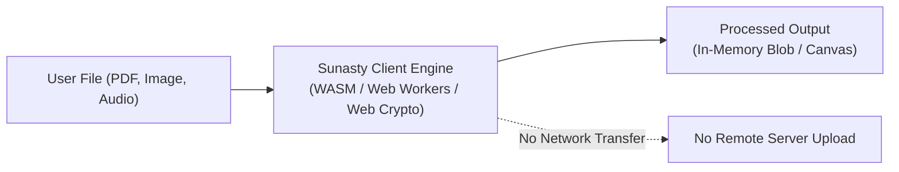

# Sunasty Developer Documentation

Welcome to the official developer documentation and technical architecture reference for **Sunasty** libraries, client-side algorithms, and developer tools.

## The Zero-Knowledge Client-Side Philosophy

Sunasty is designed around a strict architectural invariant: **all computation is performed entirely on the client's device**. 

Whether parsing PDF documents, inspecting EXIF metadata, demuxing audio tracks, or computing OKLCH contrast ratios, zero bytes of user data ever leave the browser. By leveraging standard Web APIs (HTML5 Canvas, Web Crypto API, TypedArray buffers, Web Workers) and WebAssembly, Sunasty delivers native-speed processing with complete data privacy.

## Open-Source Packages Overview

The core mathematical and parsing engines powering Sunasty are published as zero-dependency open-source packages across major package registries:

| Package | Language | Ecosystem | Registry Link |
| :--- | :--- | :--- | :--- |
| **`sunasty-color-math`** | JavaScript / TypeScript | Node.js / Browser | [npm: sunasty-color-math](https://www.npmjs.com/package/sunasty-color-math) |
| **`sunasty-color-math`** | Python 3.8+ | PyPI | [PyPI: sunasty-color-math](https://pypi.org/project/sunasty-color-math/) |
| **`sunasty-color-math`** | Rust 2021 | Cargo / crates.io | [crates.io: sunasty-color-math](https://crates.io/crates/sunasty-color-math) |
| **`sunasty-color-math-go`** | Go 1.20+ | Go Modules | [pkg.go.dev/github.com/bsulyan/sunasty-color-math-go](https://pkg.go.dev/github.com/bsulyan/sunasty-color-math-go) |
| **`sunasty/color-math`** | PHP 8.1+ | Composer / Packagist | [Packagist: sunasty/color-math](https://packagist.org/packages/sunasty/color-math) |
| **`sunasty-qr-payload`** | JavaScript / TypeScript | Node.js / Browser | [npm: sunasty-qr-payload](https://www.npmjs.com/package/sunasty-qr-payload) |

## Interactive Web Suites

The algorithms documented here can be explored and tested interactively through Sunasty's web applications:

- **[Sunasty Color Picker & Palette Extractor](https://sunasty.com/color-picker/)**: Live eyedropper, OKLCH converter, accessible palette generator, and WCAG contrast checker.
- **[Sunasty Contrast Checker](https://sunasty.com/contrast-checker/)**: Automated contrast verification with live foreground/background simulation.
- **[Sunasty QR Code Scanner](https://sunasty.com/qr-scan/)**: Multi-scale offline QR decoder supporting Wi-Fi, vCard, and TOTP payloads.
- **[Sunasty QR Code Generator](https://sunasty.com/qr-code/)**: High-density vector (SVG) and raster (PNG) QR generator.
- **[Sunasty PDF Toolkit](https://sunasty.com/pdf/)**: Client-side [merge](https://sunasty.com/pdf-merge/), [compress](https://sunasty.com/pdf-compress/), and [metadata](https://sunasty.com/pdf-metadata/) utilities.
- **[Sunasty Privacy & EXIF Inspector](https://sunasty.com/exif-reader/)**: Local metadata extraction and stripping for JPEG, PNG, and C2PA manifests.
- **[Sunasty Developer Suite](https://sunasty.com/dev/)**: In-browser tools for JSON formatting, regex testing, hash generation, and color transforms.
- **[Ulysan Studio](https://ulysan.fr/)**: Digital engineering studio behind Sunasty and creator of [Solitaire for Android](https://ulysan.fr/solitaire/).

## Documentation Sections

1. **[Color Math & Accessibility](color-math/concepts.md)**: sRGB linearization, WCAG 2.1 contrast formulas, OKLCH perceptual color space, and multi-language implementation guides.
2. **[QR Code & Payloads](qr/payload-schemas.md)**: Specifications for Wi-Fi, vCard, and TOTP QR payloads with in-browser Web Crypto HMAC evaluation.
3. **[Client-Side Architecture](architecture/pdf-engine.md)**: Engineering deep dives into client-side PDF manipulation, EXIF/C2PA stripping, and WebAssembly audio processing.
4. **[Ecosystem & Registries](ecosystem.md)**: Summary of all distribution channels, browser extensions, and developer resources.
