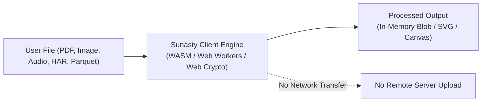

# Sunasty Developer Documentation

Welcome to the official developer documentation and technical architecture reference for **Sunasty** libraries, client-side algorithms, and 233 browser-local tools across 32 languages.

## The Zero-Knowledge Client-Side Philosophy

Sunasty is designed around a strict architectural invariant: **all computation is performed entirely on the client's device**.

Whether parsing PDF documents, stripping EXIF/C2PA/HAR secrets, viewing Parquet or SQLite tables, demuxing audio tracks, encoding vector barcodes, or computing OKLCH contrast ratios, zero bytes of user data ever leave the browser. By using standard Web APIs (HTML5 Canvas, Web Crypto API, TypedArray buffers, Web Workers) and WebAssembly, Sunasty delivers fast local processing with complete data privacy.

## Open-Source Packages Overview

The core mathematical, sanitization, and parsing engines powering Sunasty are published as zero-dependency MIT libraries across major package registries:

| Package | Language | Ecosystem | Registry Link |
| :--- | :--- | :--- | :--- |
| **`har-clean`** | JS / TS | npm · JSR · GitHub | [npm](https://www.npmjs.com/package/har-clean) · [JSR `@sunasty/har-sanitizer`](https://jsr.io/@sunasty/har-sanitizer) · [GitHub](https://github.com/bsulyan/sunasty-har-sanitizer) |
| **`swiss-math`** | JS / TS | npm · JSR · GitHub | [npm](https://www.npmjs.com/package/swiss-math) · [JSR `@sunasty/tournament-math`](https://jsr.io/@sunasty/tournament-math) · [GitHub](https://github.com/bsulyan/sunasty-tournament-math) |
| **`barcode128-svg`** | JS / TS | npm · JSR · GitHub | [npm](https://www.npmjs.com/package/barcode128-svg) · [JSR `@sunasty/code128-svg`](https://jsr.io/@sunasty/code128-svg) · [GitHub](https://github.com/bsulyan/sunasty-code128-svg) |
| **`oklch-wcag`** | JS / TS | npm · JSR · GitHub | [npm](https://www.npmjs.com/package/oklch-wcag) · [JSR `@sunasty/color-math`](https://jsr.io/@sunasty/color-math) · [GitHub](https://github.com/bsulyan/sunasty-color-math) |
| **`qr-payload-parser`** | JS / TS | npm · JSR · GitHub | [npm](https://www.npmjs.com/package/qr-payload-parser) · [JSR `@sunasty/qr-payload`](https://jsr.io/@sunasty/qr-payload) · [GitHub](https://github.com/bsulyan/sunasty-qr-payload) |
| **`sunasty-color-math`** | Python 3.8+ | PyPI | [PyPI: sunasty-color-math](https://pypi.org/project/sunasty-color-math/) |
| **`sunasty-color-math`** | Rust 2021 | Cargo / crates.io / docs.rs | [crates.io](https://crates.io/crates/sunasty-color-math) · [docs.rs API](https://docs.rs/sunasty-color-math/latest/sunasty_color_math/) |
| **`sunasty_color_math`** | Dart 3 / Flutter | pub.dev | [pub.dev: sunasty_color_math](https://pub.dev/packages/sunasty_color_math) ([publisher: sunasty.com](https://pub.dev/publishers/sunasty.com)) |
| **`sunasty-color-math-go`** | Go 1.20+ | Go Modules | [pkg.go.dev/github.com/bsulyan/sunasty-color-math-go](https://pkg.go.dev/github.com/bsulyan/sunasty-color-math-go) |
| **`sunasty/color-math`** | PHP 8.1+ | Composer / Packagist | [Packagist: sunasty/color-math](https://packagist.org/packages/sunasty/color-math) |
| **Sunasty QR Scanner** | MV3 Extension | Chrome / Firefox / Edge | [Chrome Web Store](https://chromewebstore.google.com/detail/sunasty-qr-code-scanner-g/fbiighpklpogdbnhdapbiijcadhlijcb) · [Firefox AMO](https://addons.mozilla.org/en-US/firefox/addon/sunasty-qr-code-scanner-genera/) · [Edge Add-ons](https://microsoftedge.microsoft.com/addons/detail/sunasty-qr-code-scanner-generator/npbppaegpbeefpfaffjgphjecmgbngab) |
| **Sunasty Color Picker** | MV3 Extension | Edge / GitHub | [Edge Add-ons](https://microsoftedge.microsoft.com/addons/detail/jcjfhbbmbnehefadhmhhegoccbdcfkgm) · [GitHub](https://github.com/bsulyan/sunasty-color-picker) |

## Interactive Web Suites

The algorithms documented here power Sunasty's 233 client-side web tools at [sunasty.com](https://sunasty.com/):

- **[Sunasty HAR Sanitizer](https://sunasty.com/har-sanitizer/)**: Client-side HAR 1.2 secret redaction and waterfall inspection.
- **[Sunasty Tournament Calculator](https://sunasty.com/tournament-calculator/)**: Swiss round tables, Top Cut probabilities, and OMW% Monte-Carlo tiebreak simulation.
- **[Sunasty Barcode Generator](https://sunasty.com/barcode-generator/)**: Code 128B/C, EAN-13, UPC-A, Code 39, and ITF-14 vector SVG generation plus [CSV label sheets](https://sunasty.com/csv-label-sheet/).
- **[Sunasty Color Picker & Contrast Checker](https://sunasty.com/color-picker/)**: Live eyedropper, OKLCH conversion, and [WCAG 2.1 verification](https://sunasty.com/contrast-checker/).
- **[Sunasty QR Scanner](https://sunasty.com/qr-scan/) & [QR Generator](https://sunasty.com/qr-code/)**: Multi-scale local QR decoding (Wi-Fi, vCard, TOTP) and vector QR rendering.
- **[Sunasty PDF Toolkit](https://sunasty.com/pdf/)**: Client-side [merge](https://sunasty.com/pdf-merge/), [compress](https://sunasty.com/pdf-compress/), [metadata](https://sunasty.com/pdf-metadata/), and [TCG proxy print sheets](https://sunasty.com/tcg-proxy-print/).
- **[Sunasty Privacy & Forensics](https://sunasty.com/exif-reader/)**: Local EXIF/GPS inspection and [C2PA Content Credentials verification](https://sunasty.com/c2pa-reader/).
- **[Sunasty Developer Suite](https://sunasty.com/dev/)**: Browser-local [Parquet Viewer](https://sunasty.com/parquet-viewer/), [SQLite Viewer](https://sunasty.com/sqlite-viewer/), [JSON Diff](https://sunasty.com/json-diff/), regex tester, and formatters.
- **[Ulysan Studio](https://ulysan.fr/)**: Independent engineering studio behind Sunasty and creator of [Solitaire for Android](https://ulysan.fr/solitaire/).

## Documentation Sections

1. **[Color Math & Accessibility](color-math/concepts.md)**: sRGB linearization, WCAG 2.1 contrast formulas, OKLCH perceptual color space, and multi-language implementation guides.
2. **[QR Code & Payloads](qr/payload-schemas.md)**: Specifications for Wi-Fi, vCard, and TOTP QR payloads with in-browser Web Crypto HMAC evaluation.
3. **[Client-Side Architecture](architecture/pdf-engine.md)**: Engineering deep dives into client-side PDF manipulation, EXIF/C2PA stripping, and WebAssembly audio processing.
4. **[Ecosystem & Registries](ecosystem.md)**: Summary of all distribution channels, browser extensions, packages, and developer resources.
